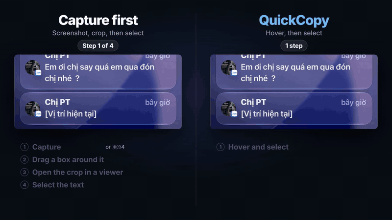
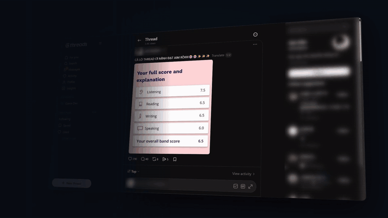
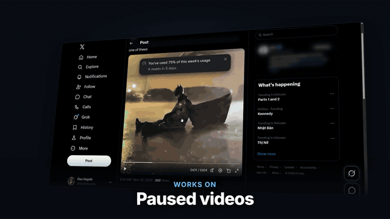

# QuickCopy

[](https://github.com/duckvhuynh/quickcopy/actions/workflows/ci.yml)
[](https://github.com/duckvhuynh/quickcopy/releases/latest)
[](#license)

**Live Text for Windows. Rest your cursor on any image and its text becomes selectable.**

A screenshot someone sent you in chat, a photo of a receipt, a slide in a
paused YouTube video: hover over it for a moment, drag across the words and
press Ctrl+C. Snipping Tool and PowerToys Text Extractor make you press a
shortcut and cut out a region first. QuickCopy reads the image as soon as
the cursor rests on it, and the image never leaves your PC.



Press Ctrl+T and the selection is translated on top of the image, in the
original's colors and size, so a screenshot of an English article reads
as if it were written in Vietnamese (or any other language Google
Translate has). QuickCopy reads English and Vietnamese, with every tone
mark.



It stays out of the way: a 1 MB program in the tray that uses about 4 MB
of memory when it starts and never touches the GPU. Reading Vietnamese
loads a model that takes about 65 MB while it works; a minute after the
last read it lets go of it, and QuickCopy sits at about 13 MB.

## What it does



- Works on images in browsers and desktop apps, including apps like Zalo
  that hide their images from accessibility tools. Tested in Edge, Brave,
  Firefox, Facebook's photo viewer, Zalo, Photos, Media Player and VLC.
- Reads whatever a desktop app draws itself, such as a canvas, a game or a
  remote desktop. Only real text and controls are left to the app.
- Reads the frame of a paused video in the browser, Media Player and VLC,
  and leaves a playing video alone.
- Selects like a text editor: drag, double-click a word, triple-click a
  line, Shift+click, Shift+arrows, Ctrl+A.
- Keeps columns, tables and panes apart, so dragging down one column
  doesn't pick up the one beside it.
- Translates with Google Translate and paints the result over the original
  in matching colors, as Google Lens does.
- Reads Vietnamese with full tone marks, using the VieSVTR model it
  downloads the first time it runs.
- Matches Windows light or dark mode and your accent color. The app itself
  is in English or Vietnamese.
- Updates itself from GitHub Releases and checks each download's SHA-256
  hash before installing it.

## Install

1. Download `QuickCopy-X.Y.Z-windows-x64.zip` from the
   [latest release](https://github.com/duckvhuynh/quickcopy/releases/latest).
2. Unzip it into any folder. QuickCopy needs no installer and no
   administrator rights.
3. Run `quickcopy.exe`. Its settings window opens, and its icon appears
   in the notification area. Closing the settings leaves QuickCopy running
   there.

With [Scoop](https://scoop.sh):

```powershell
scoop bucket add duckvhuynh https://github.com/duckvhuynh/scoop-bucket
scoop install duckvhuynh/quickcopy
```

To start QuickCopy when you sign in, turn on **Start with Windows** in its
settings. It then starts in the tray, without the settings window.

### Verify the download

Each release has a `SHA256SUMS.txt` file. In PowerShell, in the folder that
holds the download, run this to compare the zip's hash with that file. It
prints `True` when they match:

```powershell
$zip = "QuickCopy-X.Y.Z-windows-x64.zip"
$want = (Select-String -Path SHA256SUMS.txt -SimpleMatch $zip).Line.Split(" ")[0]
(Get-FileHash $zip -Algorithm SHA256).Hash -eq $want
```

Each release file also has a build provenance attestation, made by the
GitHub Actions workflow that built it. With the [GitHub CLI](https://cli.github.com/),
run this to check that the file was built from this repository:

```powershell
gh attestation verify QuickCopy-X.Y.Z-windows-x64.zip --repo duckvhuynh/quickcopy
```

A release also has the executable on its own,
`quickcopy-X.Y.Z-windows-x64.exe`. Verify it the same way. How releases
are built is in [docs/release.md](docs/release.md).

### Windows SmartScreen

Release builds are not code-signed. The first time you run
`quickcopy.exe`, Windows SmartScreen can show "Windows protected your PC".
Verify the download first. Then select **More info** and **Run anyway**.

### Vietnamese text recognition

Windows OCR has no Vietnamese recognizer. To read Vietnamese with its tone
marks, QuickCopy uses the [VieSVTR](https://huggingface.co/ngocthua830/viesvtr)
model by ngocthua830. The model is not in the release zip, because its
license is **CC BY-NC 4.0, which allows non-commercial use only**.

The first time QuickCopy runs, it downloads the model (`viesvtr_v7.onnx`,
30.7 MB) from that page, checks its SHA-256 hash and saves it to
`%LOCALAPPDATA%\QuickCopy\models\viesvtr\`. The settings show the
download's progress in percent. Without an internet connection it tries
again at the next start, or when you select **Retry** in the settings.
To stop using the model, turn off **Vietnamese text recognition** in the
settings, then delete the file; QuickCopy does not download it again while
the setting is off.

The model runs on ONNX Runtime, which the release zip carries in its
`runtime\` folder with the Visual C++ runtime it needs, so this works on
Windows 10 as well as Windows 11.

To install the model by hand instead, save `weights/viesvtr_v7.onnx` from
the model's page as `models\viesvtr\viesvtr_v7.onnx` in that
`%LOCALAPPDATA%\QuickCopy` folder or in the folder that holds
`quickcopy.exe`. The release zip already has `vi_syllables.bin` in
`models\viesvtr`; without it, tone marks are read as the model reads them.

## Usage

### Select and copy

Rest the cursor on an image for a moment. QuickCopy reads it and lays a
transparent overlay over its text lines. Clicks elsewhere on the image
still go to the app underneath. In an area a desktop app draws itself, a
click on its text goes to the app as well, and a drag selects.

- Drag over text to select it. The drag can start a little before or after
  a line.
- Double-click a word or triple-click a line.
- Extend the selection with Shift+click, Shift+arrows, Ctrl+Shift+arrows,
  Shift+Home and Shift+End. Select all with Ctrl+A.
- Copy with Ctrl+C, Ctrl+Insert or the menu that appears next to the
  selection.

The selection stays until you click elsewhere or press Esc. Other keys go
to the app underneath.

### Translate

Select text and press the translate shortcut (Ctrl+T by default), or pick
**Translate** in the selection menu. The translation is painted over the
original in the same boxes, with the background and text colors sampled
from the image. Text already in the target language is translated to
English, or to Vietnamese when English is the target. Ctrl+C copies the translation. Esc shows the original again.

### Videos

Pause a video and rest the cursor on it. The paused frame is read like an
image. This works on web pages and in Media Player and VLC. A video counts
as playing while its picture moves or while its Windows media session says
it is playing, so a still picture with music is not read.

You do not need to move the mouse after you pause. While the cursor rests on
a playing video, QuickCopy checks it twice a second, which costs about 1-2%
of one CPU core. The overlay appears after a pause and goes away within a
second when the video plays again. Text that the player draws over the
picture, such as its control bar, time and captions, is left out, so the
overlay never takes the player's clicks.

### Settings

Open the settings from the tray icon (**Settings…**), by double-clicking the
tray icon, or by starting `quickcopy.exe` again, which opens the settings
of the copy that is running. `quickcopy --tray` starts QuickCopy without
opening the settings; **Start with Windows** uses it.

- **Start with Windows**.
- **Translate into**: any of Google Translate's languages, with search.
- **Translate shortcut**: Ctrl+T by default.
- **App language**: English or Vietnamese.
- **Vietnamese text recognition**: on or off, once the VieSVTR model is
  downloaded; until then, the download's progress.
- **Check for updates automatically**: the daily update check.
- **Version**: the running version, and a button that checks for updates
  and shows the result, or offers **Update to X.Y.Z**.

Settings are saved in `%APPDATA%\QuickCopy\settings.json`. The Start with
Windows setting is stored only in the `HKCU` Run key.

### Tray icon

Right-click the tray icon for **Settings…**, **Pause** and
**Quit QuickCopy**. While QuickCopy is paused, it reads nothing.

### Updates

QuickCopy checks GitHub Releases for a newer version once a day. When one
exists, the tray menu shows **Update to X.Y.Z**. Select it to download the
new version. QuickCopy checks the download's SHA-256 hash before it
installs it, swaps the exe and restarts; if the new version does not
start, the old one is put back. Turn off **Check for updates
automatically** in the settings to stop the daily check; **Check now** in
the settings checks at once. The update replaces `quickcopy.exe` only, so
keep QuickCopy in a folder you can write to (for example under
`%LOCALAPPDATA%`), not in Program Files. `quickcopy --check-update`
prints what the check finds without installing anything.

## Privacy

- All text recognition runs on your PC, with Windows OCR and, for
  Vietnamese, the VieSVTR model. Images are never uploaded.
- Translation sends the selected text to Google, and only when you ask for
  a translation. QuickCopy uses the endpoint and public key of the Google
  Translate web client. That is not an official Google API, and Google can
  change or block it. Set the `QC_GOOGLE_KEY` environment variable to use
  your own key.
- The update check contacts `api.github.com` once a day. Turn off
  **Check for updates automatically** to stop it.
- The first start contacts `huggingface.co` once, to download the
  Vietnamese model.
- QuickCopy sends nothing else and collects no usage data.

## Requirements

- Windows 10 or Windows 11, x64.
- A Windows OCR language. QuickCopy uses the English (United States) OCR
  language if it is installed, otherwise the OCR languages of your Windows
  display languages. Adding English (United States) in **Settings** >
  **Time & language** > **Language & region** installs it. To check which
  OCR languages are installed, run this in PowerShell:

  ```powershell
  Get-WindowsCapability -Online -Name "Language.OCR*" | Where-Object State -eq Installed
  ```

- For Vietnamese only: the VieSVTR model, which QuickCopy downloads, and
  ONNX Runtime 1.17 or newer, which is in the zip's `runtime\` folder
  (without it, QuickCopy uses the copy Windows 11 has in `System32`). See
  [Vietnamese text recognition](#vietnamese-text-recognition).

## Build from source

You need Rust 1.92 or newer with the `x86_64-pc-windows-msvc` toolchain,
and the Visual Studio Build Tools with a Windows SDK. `build.rs` compiles
the icon resources with the SDK's resource compiler.

```powershell
git clone https://github.com/duckvhuynh/quickcopy
cd quickcopy
cargo build --release
```

The executable is `target\release\quickcopy.exe`. It finds the
`models\viesvtr` folder of the repository, because it looks in the parent
folders of the executable. Run the unit tests with `cargo test --release`.

## How it works

When the cursor rests for 150 ms, QuickCopy asks UI Automation what is
under it. Where UI Automation reports no image, as in Electron apps, it
finds the image from pixels. It captures the image, upscales it 2x and
reads it with Windows OCR. Lines that Windows OCR skips are cut out and
read again. In Vietnamese mode, VieSVTR reads the lines again, and a table
of syllable frequencies picks uncertain tone marks. A transparent overlay
covers only the text lines. Lines are grouped into blocks, so a selection
follows columns and table rows. Results are cached by pixel hash.

On a 14-line Vietnamese page, the overlay appears about 370 ms after the
cursor rests on a new image (about 200 ms on an image already read), and
the Vietnamese text is ready after about 500 ms.

The details, with the source file for each step, are in
[docs/ARCHITECTURE.md](docs/ARCHITECTURE.md). The test tools and debug
flags are in [docs/TESTING.md](docs/TESTING.md).

## Known limitations

- Not every app can be read. QuickCopy cannot read pictures that an app
  draws without telling UI Automation (top-level windows drawn by hand, as
  in games), named canvases in editors such as Paint, thumbnails inside
  list items (Media Player's library, File Explorer), DRM-protected video
  (Netflix shows black to screen captures), and windows that run as
  administrator. Classic Windows Media Player was not tested.
- In Electron apps, images on wallpapers or with edges close to the
  background color may not be found.
- OCR gives a box per word, not per letter. A selection that starts or ends
  inside a word divides the word's box evenly, so the caret can be a letter
  off in proportional fonts.
- Select all reads block after block. For a table whose columns are far
  apart, that is column by column. A drag over its rows reads row by row.
- A single click on a word inside an image goes to the overlay, so an image
  link does not open when you click exactly on its text.
- A muted video whose picture does not move counts as paused.
- Over a paused video, picture text between the buttons of a control bar,
  or under the player's controls or captions, is left out with them.
- A video with a still picture that started playing less than a second ago
  can count as paused until Windows lists its media session. The overlay,
  still invisible, goes away at the next check, 0.3 s later.

## Roadmap

- Linux support. The plan is in [docs/linux.md](docs/linux.md).

## Contributing

Bug reports, test images and pull requests are welcome. Read
[CONTRIBUTING.md](CONTRIBUTING.md) for how to build, test and send a
change. Report security problems privately, as described in
[SECURITY.md](SECURITY.md). Everyone taking part follows the
[code of conduct](CODE_OF_CONDUCT.md).

## License

QuickCopy's code is licensed under either of these, at your option:

- Apache License, Version 2.0 ([LICENSE-APACHE](LICENSE-APACHE))
- MIT license ([LICENSE-MIT](LICENSE-MIT))

Unless you explicitly state otherwise, any contribution intentionally
submitted for inclusion in QuickCopy by you, as defined in the Apache-2.0
license, shall be dual licensed as above, without any additional terms or
conditions.

These parts have their own licenses:

- The VieSVTR model is CC BY-NC 4.0. It is not in this repository or in
  releases; QuickCopy downloads it from its author's page.
- `models/viesvtr/vi_syllables.bin` is counted from Vietnamese Wikipedia
  and is licensed CC BY-SA 4.0.

[THIRD-PARTY-NOTICES.md](THIRD-PARTY-NOTICES.md) lists these and every Rust
crate QuickCopy uses, with their licenses.
